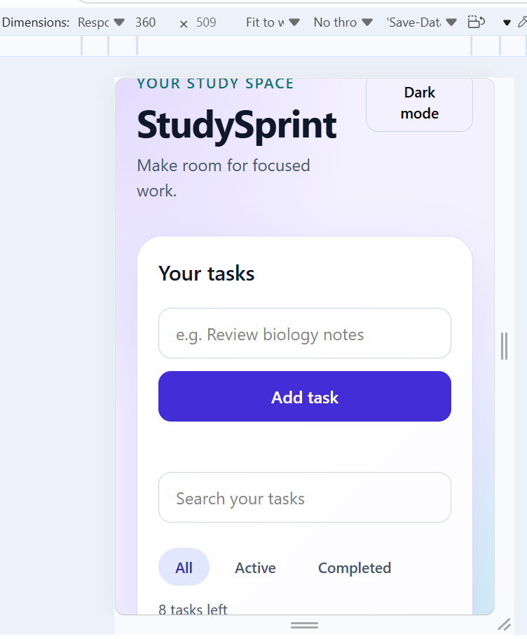
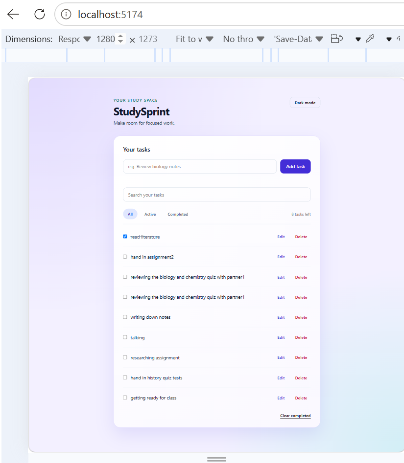

# StudySprint

A focused study task list for organizing work, tracking progress, and keeping tasks between visits.

**Student:** [Dinah]

[Open StudySprint](https://helpful-tartufo-bebdcf.netlify.app)

## Features

- Add tasks with input validation
- Complete, edit, and delete tasks
- Filter by All, Active, and Completed
- See the number of tasks left
- Clear completed tasks
- Save tasks and the selected filter between visits
- **Extra: Search tasks as you type**
- **Extra: Remember dark mode**

## User stories

- I can add a study task and get a helpful message if my input is invalid.
- I can mark a task complete or active, edit it, and delete it with confirmation.
- I can filter tasks and see how many are left.
- I can clear completed tasks.
- I can search as I type and get a message when there are no matches.
- My tasks, selected filter, and theme are remembered after a refresh.

## State shape

Each task is stored as an object:

```js
{
  id: "unique-id",
  text: "Review biology notes",
  completed: false
}

## Screenshots

### Mobile



### Desktop



## Challenges and What I Learned
I learned how to keep tasks in an array and update the page with a render() function.
I used event delegation so task buttons work even when tasks are added later.
I learned how to save tasks, the selected filter, and dark mode in localStorage.
I used browser DevTools to check the app at mobile and desktop widths.
During testing, I found that the light card gradient made text difficult to read in dark mode, so I adjusted the card’s dark-mode background.
I also learned to use textContent so task text appears as plain text instead of being treated as HTML.